<div align="center">

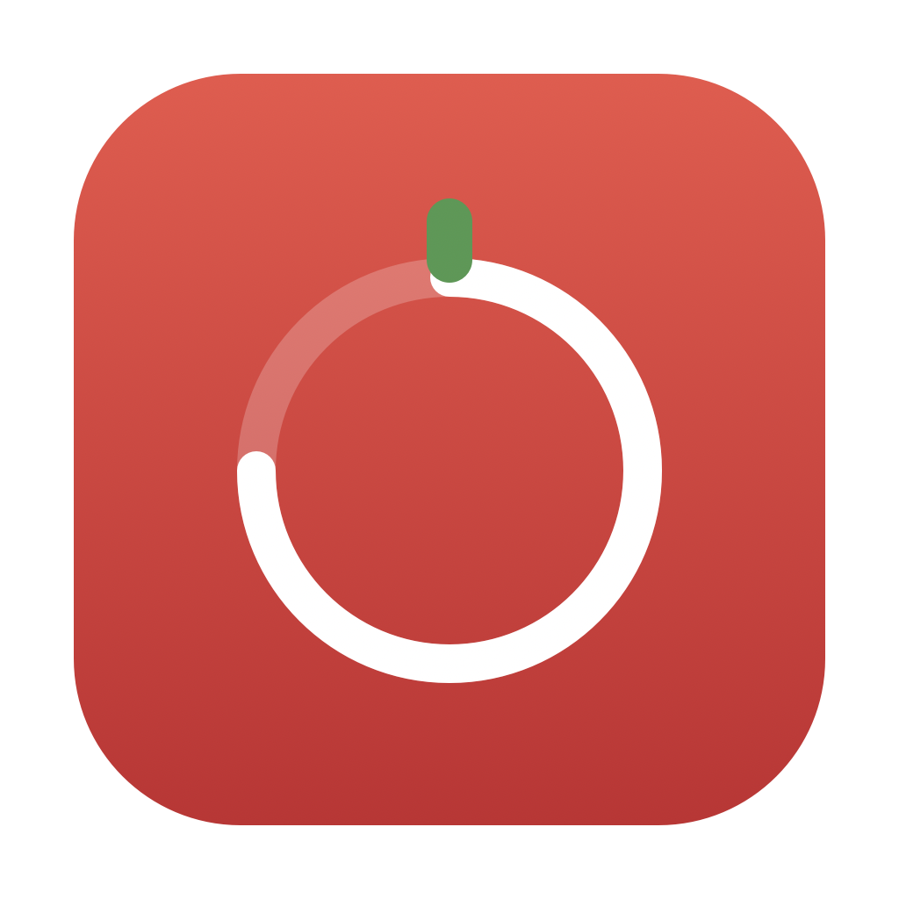

# Pomodoro

**A menu bar pomodoro timer for macOS, with a floating glass bar<br>and a small cast of characters to keep you company.**

[](#requirements)
[](https://www.swift.org)
[](https://developer.apple.com/xcode/swiftui/)
[](LICENSE)

[Install](#install) · [Features](#features) · [Make it yours](#make-it-yours) · [The cast](#the-cast) · [Build from source](#build-from-source) · [RigStudio](#rigstudio)

<br>

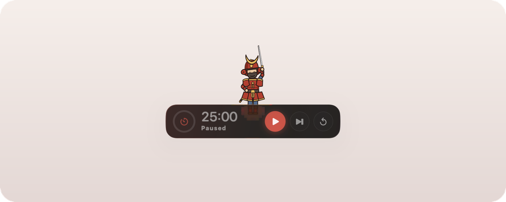

</div>

<br>

No Dock icon and no window to manage. The countdown lives in the menu bar, and a floating pill sits wherever you drop it. When a phase changes, a character pops out from behind the pill, does one short move, and goes back. You can also keep a small companion around between sessions, turn the pill upright, and pick colors of your own.

## Features

<table>
<tr>
<td width="50%" valign="top">

### ⏱&nbsp; The cycle
Focus, short break and long break, with the long break every *n* pomodoros. Every duration (1 to 240 minutes) and the cycle length can be changed. Breaks and the next focus session can each start on their own.

</td>
<td width="50%" valign="top">

### 🫧&nbsp; The floating bar
A draggable glass pill with a progress ring, the countdown and the phase. Play and pause are always there, with reset and skip on hover. It can shrink while a timer runs and opens again when you come near it.

Choose **Horizontal / Vertical** in **Settings → Timer → Orientation**. Both use
the same size and glass treatment, with upright controls and companion artwork.
Right-click the pill (or secondary-click with two fingers on a trackpad) for
**Settings…**, **Switch to Vertical / Horizontal**, and **Hide Floating Bar**.
Show it again from the menu bar's **Show Floating Bar** item.
[Floating bar behavior and implementation](docs/FLOATING-BAR.md).

</td>
</tr>
<tr>
<td valign="top">

### 🎭&nbsp; Seven characters
A samurai, a ninja, a man in a rabbit suit, a general, Power, Boa Hancock and Nel. Each has its own move for focus start, break start and long break. They are decoration; the notification and the chime do the real work.


</td>
<td valign="top">

### 🎵&nbsp; Music that follows focus
Pauses Music or Spotify when focus ends and resumes it when focus starts again. It never guesses: it only presses play on a player it can see paused, or one it paused itself.

</td>
</tr>
<tr>
<td valign="top">

### 🔔&nbsp; Alerts
A notification banner and a system chime at each change, with separate sounds for focus and break and a volume control.

</td>
<td valign="top">

### 📊&nbsp; Widget and stats
A desktop widget in small and medium sizes, with start, pause and skip buttons through App Intents. Daily pomodoros and focus time are kept in a local JSON file. Nothing leaves your Mac.

</td>
</tr>
<tr>
<td valign="top">

### 🧸&nbsp; Always-on companions
Keep your character around between performances. **Idle** stays in your chosen spot with gentle breathing and blinking; **Lively** changes sides occasionally, with a quiet rest between moves. All seven can peek over the top, hang below, or climb either side.

Choose the mode and position in **Settings → Character**. **Off** is the default. Companions follow the compact pill, adjust at screen edges, and make way for the original performances. Reduce Motion keeps them still. [Companion kit guide](docs/COMPANIONS.md).

</td>
<td valign="top">

### 🎨&nbsp; Your colors
The original palette, one inspired by each character, and a saved **Custom** palette. Preview each phase, pick its color, and tune the glass tint. Choose **System**, **Light** or **Dark**, and use **Match character** when you want the colors to follow your pick.

Open **Settings → Appearance**. Colors carry through the floating bar, menu header, settings, statistics and widgets. Character artwork keeps its own colors. [Appearance guide and UI map](docs/THEMING.md).

</td>
</tr>
</table>

## Make it yours

Same timer, a little more personality. These images use the app's native views and bundled artwork, captured with temporary preferences.

<div align="center">

<br><sub>Lively's first relocation, replayed here. In the app, moves are separated by 26-second rests.</sub>
</div>

<details>
<summary><b>See the still companion preview</b></summary>
<br>

</details>

<br>

<table>
<tr>
<td align="center" width="50%" valign="top">

<br><b>Your palette</b><br><sub>Pick a character theme or make your own</sub>
<br><sub><a href="docs/images/qol-custom-colors.png">See the custom-color controls</a></sub>
</td>
<td align="center" width="50%" valign="top">

<br>

<br><b>Your orientation</b><br><sub>The same pill, turned upright</sub>
</td>
</tr>
<tr>
<td align="center" colspan="2">

<br><b>Just a right-click away</b><br><sub>Settings, orientation and visibility</sub>
</td>
</tr>
</table>

## The cast

Each character has three moves. Here is one move from each, recorded from the real app.

<table>
<tr>
<td align="center" width="33%">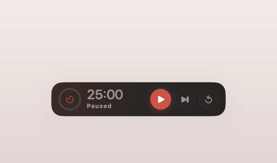<br><b>Samurai</b><br><sub>Victory cry on a long break</sub></td>
<td align="center" width="33%">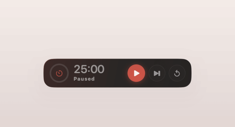<br><b>Ninja</b><br><sub>Appears, throws, vanishes</sub></td>
<td align="center" width="33%">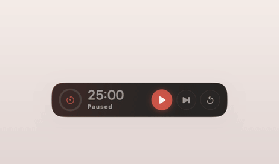<br><b>Rabbit Suit Guy</b><br><sub>Mascot mode, for once</sub></td>
</tr>
<tr>
<td align="center">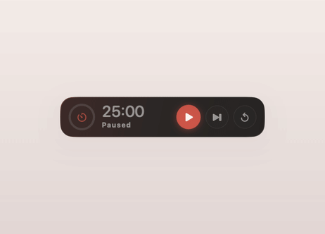<br><b>The General</b><br><sub>Inspection before focus</sub></td>
<td align="center">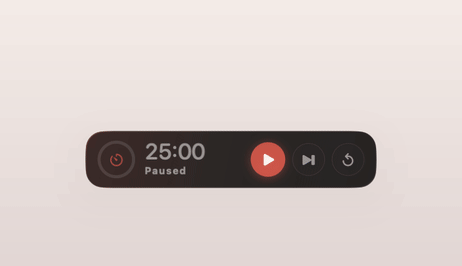<br><b>Power</b><br><sub>Hey hey hey!</sub></td>
<td align="center">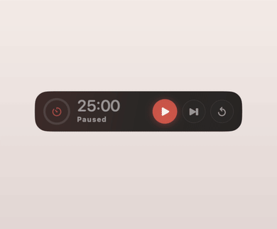<br><b>Boa Hancock</b><br><sub>The Empress, laughing</sub></td>
</tr>
</table>

| Character | Focus starts | Break starts | Long break |
| --- | --- | --- | --- |
| **Samurai** | One clean cut | Rests on his blade and dozes | Jumps with the blade raised |
| **Ninja** | Smoke in, shuriken, smoke out | Naps on the edge of the bar | Backflip and a bow |
| **Rabbit Suit Guy** | A very reluctant salute | One hop of mandatory fun | Commits to a spin and a ta-da |
| **The General** | Taps his stick, points, salutes | At ease, peeks over his shades | Two-step parade and a raised stick |
| **Power** | "Grovel, human!" | A huge yawn, then a nap on the bar | Her signature laughing pose |
| **Boa Hancock** | Looks down on you, points, winks | Love-struck, with a heart | Sweeps her cape and laughs "hohoho" |
| **Nel** | Thinks, then gives a little nod | A friendly wave | Two happy hops and a wave |

Pick one, or none, in Settings.

### Nel, a little closer

Her mint hair, ram skull and sage outfit follow the original Codex companion.
The cycle animations use her original sprite artwork; the hanging poses are new
adaptations of the same design. Her matching palette is mint, sage and warm ivory.

<p align="center">
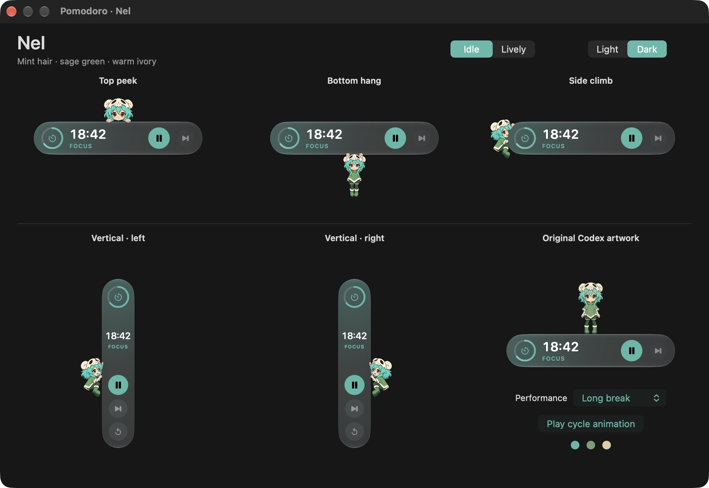
<br><sub>Native review board using the app's real views</sub>
</p>

<details>
<summary>See Nel in motion and in light mode</summary>
<p align="center">
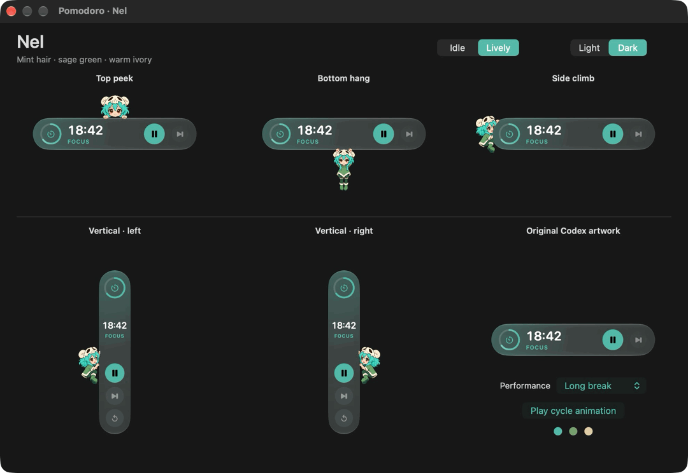
<br><sub>The first Lively move; the app then rests for 26 seconds</sub>
</p>
<p align="center">
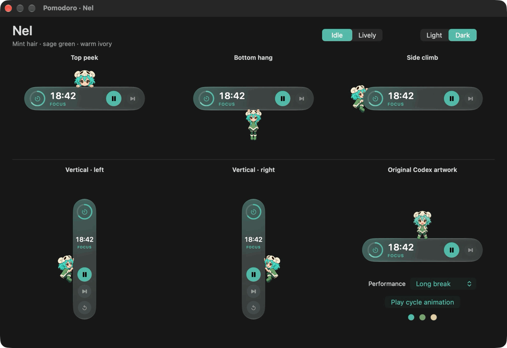
</p>
<p align="center">
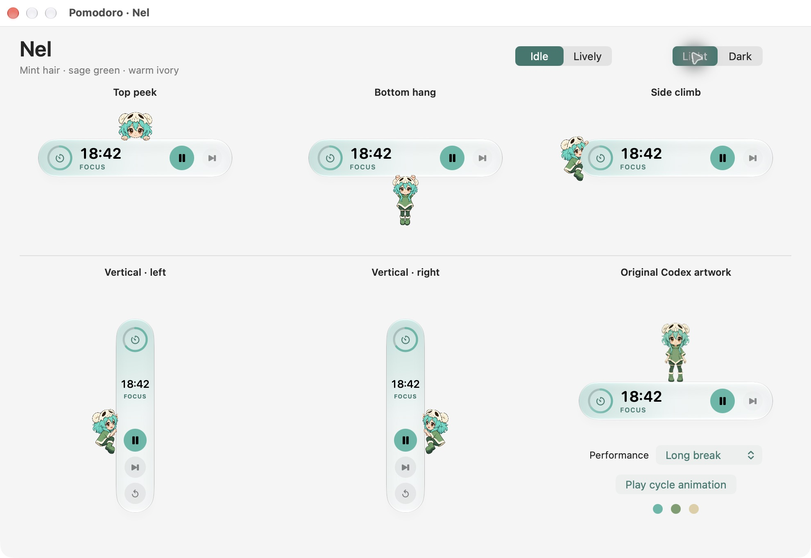
</p>
</details>

Artwork, sequencing and authoring details are in the [Nel guide](docs/NEL.md).

## Install

### Requirements

- macOS 14 or later
- Xcode 16 or later (for the Swift 6 toolchain)

### Build and install

```bash
git clone https://github.com/YorgoTabet/pomodoro-timer.git
cd pomodoro-timer
./Scripts/build.sh
```

This builds the app and the widget in release mode, puts them together as `Pomodoro.app`, draws the icon, signs the bundle, and copies it to `/Applications` (or `~/Applications` if the first is not writable). Open it from Launchpad or Spotlight, and look for the timer in your menu bar.

To build the bundle without installing it:

```bash
./Scripts/build.sh --no-install
```

<details>
<summary><b>Permissions keep resetting after a rebuild?</b> Read this about signing.</summary>

<br>

The build script looks for a real code signing certificate and falls back to an ad-hoc signature if it can't find one. Ad-hoc builds run fine, but macOS ties the permissions you grant (Accessibility, Notifications, Automation) to the app's signature, and an ad-hoc signature changes on every build. So media keys, notifications and Music control quietly stop working after each rebuild until you grant them again.

If you have a certificate, point the script at it:

```bash
CODESIGN_IDENTITY="Apple Development: you@example.com (XXXXXXXXXX)" ./Scripts/build.sh
```

The app is not sandboxed on purpose. Controlling Music and Spotify over AppleScript and sending media keys are both blocked inside the sandbox.

</details>

### First run

1. Click the timer in the menu bar and press **Start**.
2. Allow notifications when macOS asks.
3. Drag the ring or countdown on the floating bar wherever you like. It remembers the spot.
4. Open **Settings** from the menu bar or by right-clicking the pill to set durations, sounds, music control, your character and colors.

## Build from source

To rebuild and restart the local app without installing it:

```bash
./Scripts/build.sh --no-install --run
```

Restarting resets any active timer. Use `./Scripts/build.sh --run` to install and
launch instead. To reopen an existing build, quit Pomodoro and run
`open .build/Pomodoro.app`.

```bash
swift run Pomodoro    # run without installing
swift test            # run the tests
```

`swift run` is handy for working on the UI. Notification banners are off outside a real `.app` bundle (the API crashes otherwise), so you get the chime and nothing else.

## RigStudio

The phase-change characters are drawn from vector paths and moved by a small joint rig. Judging that by reading keyframes doesn't work, so the animation has its own workbench. It is a separate program and never ships inside the app.

```bash
swift run RigStudio
```

It plays every move with a scrubbable timeline, onion skin, joint pivots and live angles. It also runs without a window:

| Command | What it does |
| --- | --- |
| `swift run RigStudio --filmstrip <dir>` | Renders a contact sheet per character, so a move can be checked frame by frame |
| `swift run RigStudio --proportions <dir>` | Sweeps Power's proportion dials across their range, so a value is judged by eye |
| `swift run RigStudio --audit` | Lists joints a move never uses, and joints that freeze for over 0.9s in the middle of a move |

## Project layout

| Target | What lives there |
| --- | --- |
| `PomodoroCore` | The cycle rules, settings, stats and the shared store the widget reads. No AppKit and no timers |
| `PomodoroUI` | SwiftUI shared by the app and the widget, plus the character art, the rig and the moves |
| `Pomodoro` | The app: menu bar, floating bar, settings, notifications, music control |
| `PomodoroWidget` | The widget extension, built as a plain executable and put into the bundle by hand, since SwiftPM has no app extensions |
| `RigStudio` | The animation workbench |

Hanging companions use bundled sprite atlases alongside those rigs; see the [companion kit guide](docs/COMPANIONS.md) to add artwork. Design notes and specs are in [`docs/`](docs/). The [documentation image guide](docs/README-IMAGES.md) explains how to refresh the feature gallery.

## Credits

Power is a character from *Chainsaw Man* by Tatsuki Fujimoto. Boa Hancock is a character from *One Piece* by Eiichiro Oda. Both versions here are fan art, are not affiliated with or endorsed by the rights holders, and are not covered by this project's license. Nel is a character from *Bleach* by Tite Kubo; her version is also fan art with the same exclusions. The other characters are original.

## License

MIT. See [LICENSE](LICENSE).
